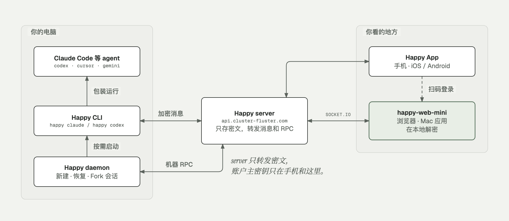

# happy-web-mini

一个最小的 [Happy](https://happy.engineering) 客户端，在浏览器或 Mac 应用里用。

Happy 让你在手机上看着、指挥电脑上跑的 Claude Code / Codex / Cursor / Gemini。这个客户端直连 Happy 官方 server，
把同样的事搬到电脑屏幕上：会话按电脑和项目排好，看 agent 的回复和工具调用，回复、批准、回答提问，
新建、归档、恢复会话，还能看到每个会话提到的链接和改了多少行代码。消息在本地端到端解密，不经过别的服务。

## 工作原理



电脑上的 Happy CLI 包着 agent 跑，daemon 负责新建、恢复、Fork 会话。它们和手机 App、这个客户端都只跟 Happy server 说话，
server 上存的、转发的都是密文。这个客户端用手机扫码（或粘贴备份密钥）拿到账户主密钥，在本地解密。

## 怎么用

**Mac 应用**：从 [Releases](https://github.com/lvgj-stack/happy-web-mini/releases) 下载最新的
`Happy-<版本>-mac-arm64.zip`（Apple 芯片）或 `-mac-x64.zip`（Intel），解压后拖进「应用程序」。
第一次打开要右键 › 打开，详见 [desktop/README.md](desktop/README.md)。

**浏览器**：

```bash
cd web
npm install
npm start            # 然后打开 http://localhost:8080
```

两种方式都用手机上的 Happy App 扫码登录（App › 关联新设备），或者粘贴备份密钥。

## 目录

| 目录 | 是什么 | 说明 |
| --- | --- | --- |
| [`web/`](web/) | 网页客户端，无构建步骤，原生 ES module | [功能说明](web/README.md) · [开发规范](web/AGENTS.md) |
| [`desktop/`](desktop/) | 把 `web/` 打包成 macOS 应用（Electron），加上菜单、Dock 角标、系统通知 | [使用说明](desktop/README.md) · [开发规范](desktop/AGENTS.md) |
| [`docs/`](docs/) | 设计稿、实现计划，README 里的图（`docs/diagrams/`） | |

功能都在 `web/` 里实现，Mac 应用打包同一份页面，所以两边功能一致。

## 安全

账户主密钥存在浏览器（或 Mac 应用）的 `localStorage` 里，能在这个页面跑 JS 的东西都能读到它。
只在自己信任的机器和域名上用；在远程机器上跑网页版时用 https 或 `ssh -L` 转发，别直接用裸 http。

## 开发

先读 [AGENTS.md](AGENTS.md)：每个改动在自己的 git worktree 里做，提交标题带 scope（`feat(web): …`），
合进 `main` 后推送，Mac 应用通过改版本号的 PR 由 CI 发版。`web/` 和 `desktop/` 各自的约定在它们的 `AGENTS.md` 里。
